<div align="center">




<br/>


<br/>


<br/><br/>


</div>


<div align="center">

</div>

<br/>

<div align="center">

Eu não entrego só scripts que funcionam. Eu entrego scripts **otimizados**, pensados para consumir pouco do servidor, evitar lag e manter tudo estável mesmo com o servidor cheio.

</div>

<br/>

<table>
  <tr>
    <td width="50%" valign="top">
      <h3>⚡ Otimizados</h3>
      Código pensado para <b>baixo consumo</b>, sem loops pesados e sem desperdício. Seu servidor roda leve.
    </td>
    <td width="50%" valign="top">
      <h3>🧼 Código limpo</h3>
      Organizado e fácil de entender. Você consegue <b>manter e evoluir</b> o script depois.
    </td>
  </tr>
  <tr>
    <td width="50%" valign="top">
      <h3>🎯 Sob medida</h3>
      Feito para o <b>seu servidor</b>, usando <b>RSG Core</b> (RedM) ou <b>vRP</b> (FiveM).
    </td>
    <td width="50%" valign="top">
      <h3>🛡️ Estável</h3>
      <b>Testado antes da entrega</b>, com correção de bugs e ajustes quando precisar.
    </td>
  </tr>
</table>


<div align="center">

</div>

- 📜 **Scripts personalizados** em Lua para RedM e FiveM
- 🚀 **Otimização** de scripts que já existem e estão pesados ou travando
- 🐞 **Correção de erros** e ajustes em recursos
- 🧱 **Criação e configuração** de servidores RedM e FiveM
- 🖥️ **Interfaces NUI** modernas com HTML, CSS e JavaScript
- 🗄️ **Integração com MySQL**

<div align="center">

**💬 Conversa  →  🧩 Planejamento  →  💻 Desenvolvimento  →  ✅ Testes e entrega**

</div>


<div align="center">

</div>

```lua
local BeeRcm = {
    nome        = "Bee Rcm",
    plataformas = { "RedM", "FiveM" },
    frameworks  = { RedM = "RSG Core", FiveM = "vRP" },
    linguagem   = "Lua",
    entrega     = { "scripts otimizados", "código limpo", "estabilidade" },
}

-- Meta de todo script: resmon baixo, servidor leve e jogadores felizes.
function BeeRcm.entregar(script)
    return otimizado(script) and testado(script)
end
```


<div align="center">

</div>

| Categoria | Tecnologias |
|---|---|
| 🧠 **Linguagem principal** |  |
| 🎮 **Plataformas** |   |
| 🧱 **Frameworks** |   |
| 🖥️ **Interface (NUI)** |    |
| 🗄️ **Banco de dados** |  |
| 🔧 **Ferramentas** |     |


<div align="center">

</div>

<div align="center">


<br/>


</div>


<div align="center">

</div>

<div align="center">

Precisa de um script novo, de um servidor configurado ou de otimizar o que já existe? **Me chame e peça seu orçamento.**

<br/>

<a href="https://github.com/bally018">
  
</a>
<!-- Descomente e coloque o seu usuário para aparecer o botão:
<a href="https://discord.com/users/SEU_ID">
  
</a>
<a href="https://instagram.com/SEU_USUARIO">
  
</a>
-->

</div>


